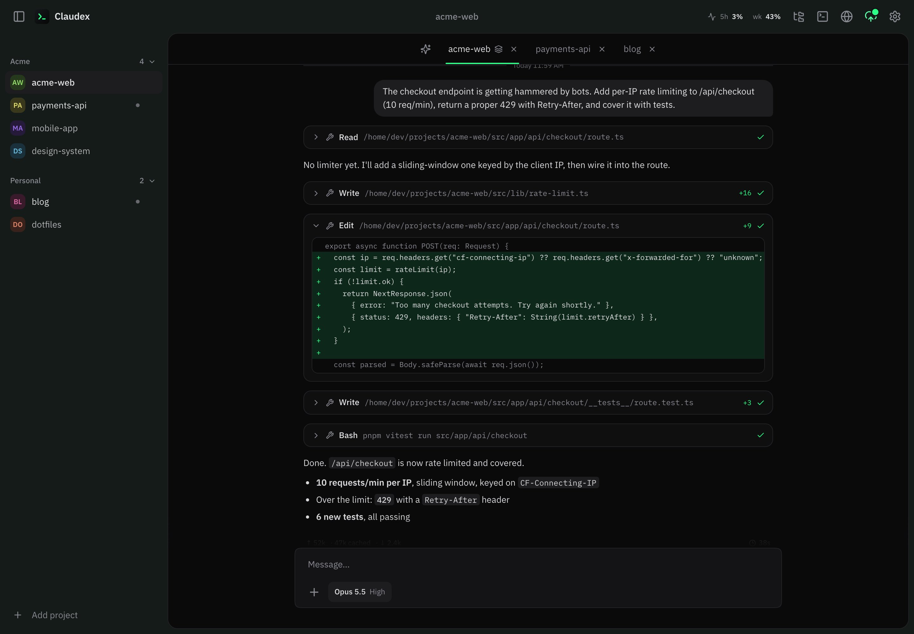
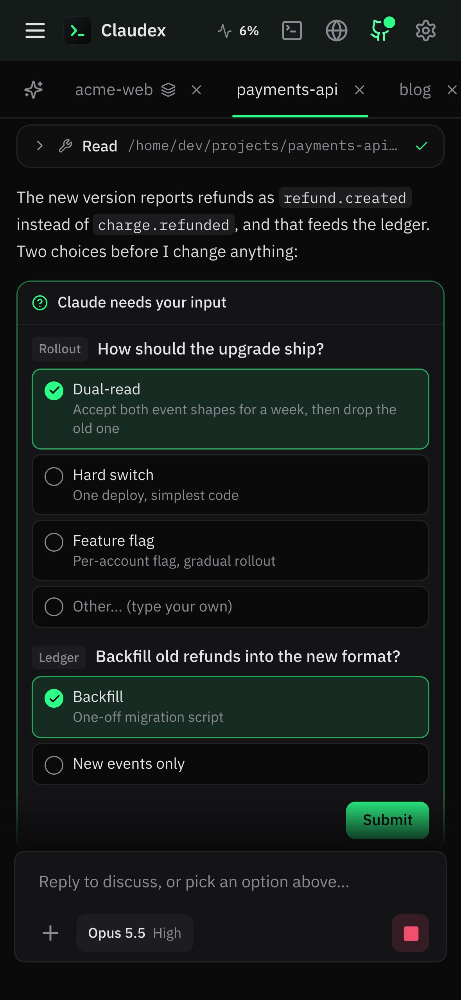
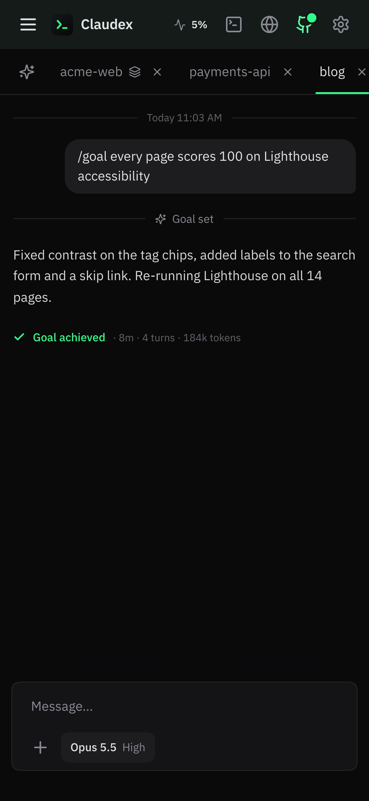
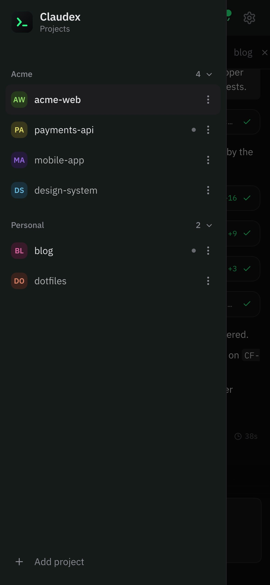
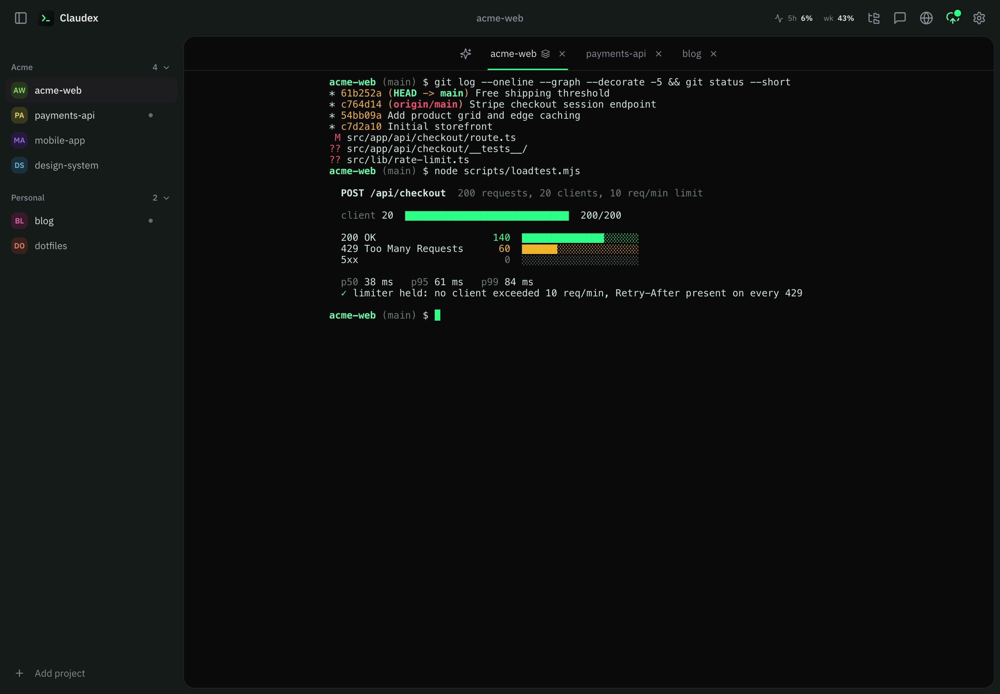
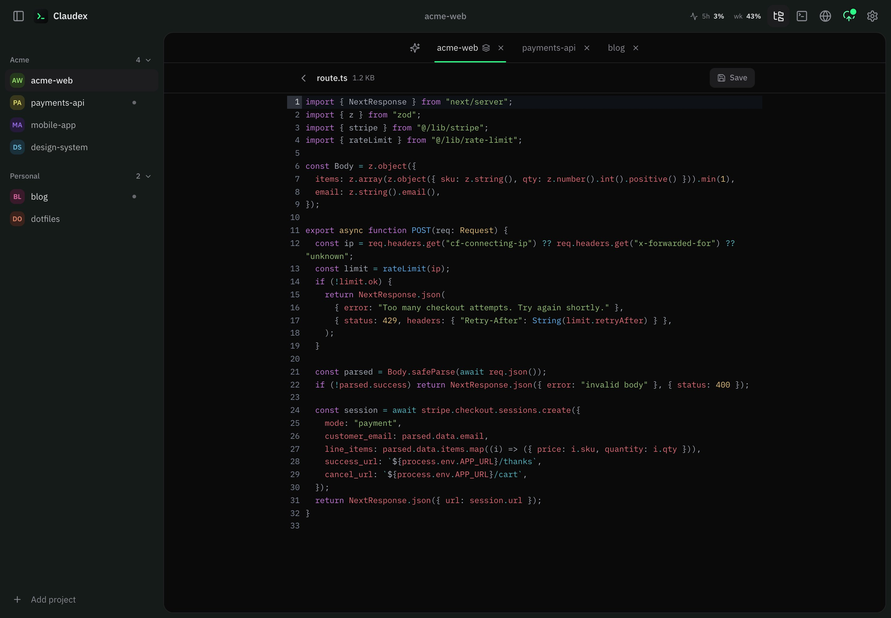
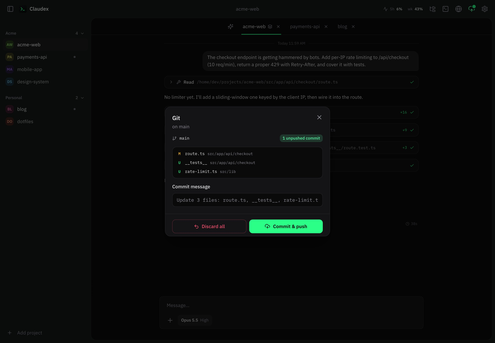
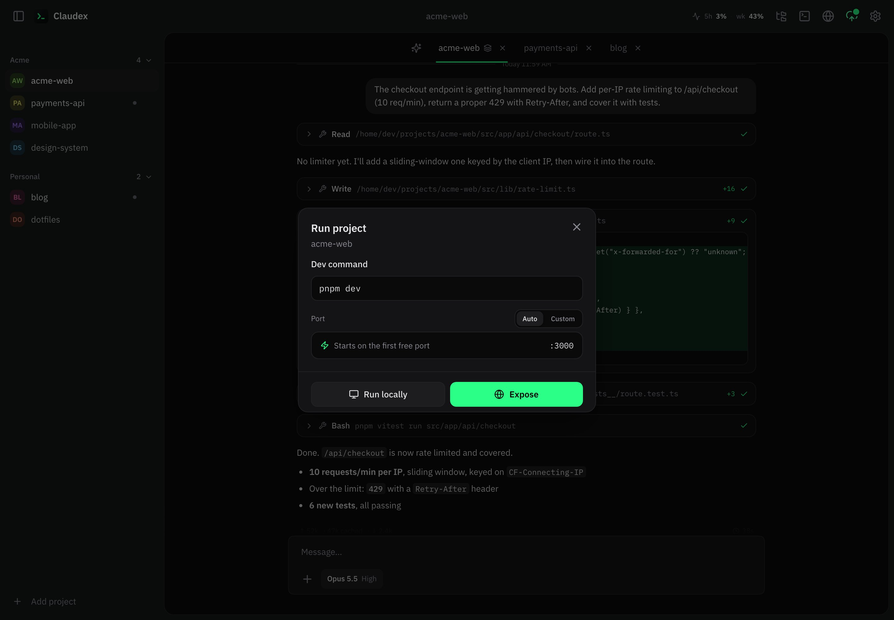
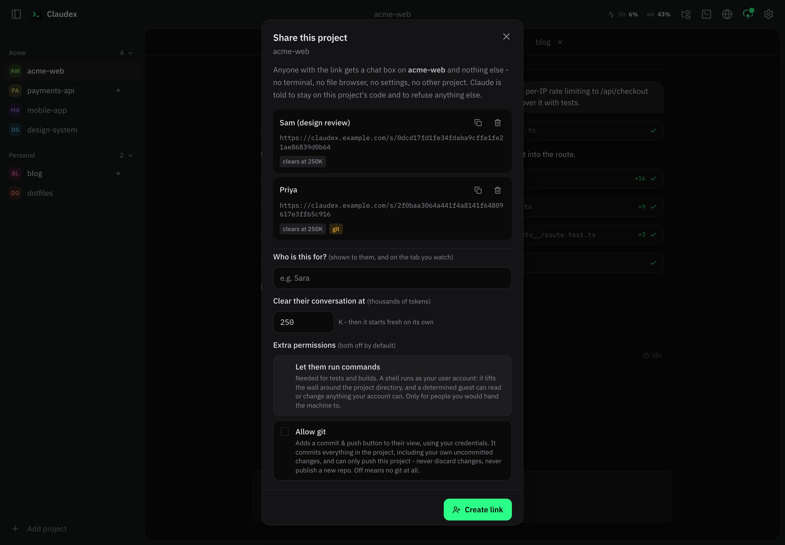
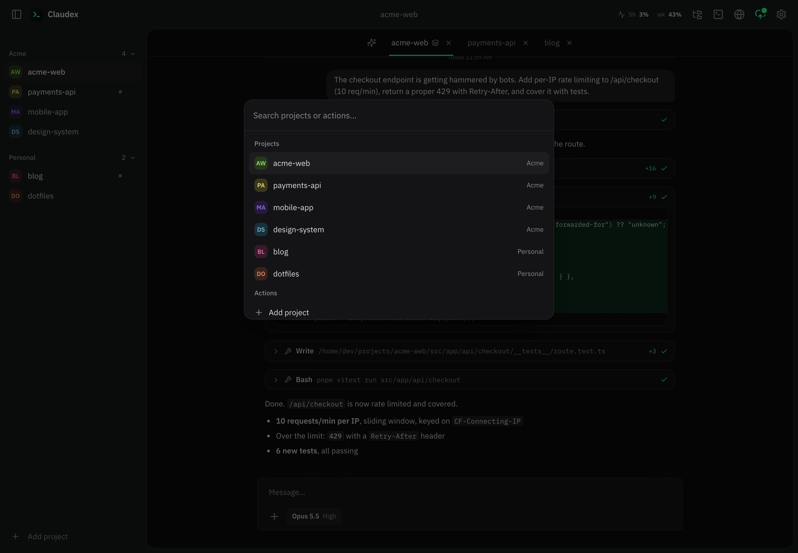

# Claudex

Self-hosted web UI for [Claude Code](https://docs.anthropic.com/en/docs/claude-code). Run it on your Mac, Linux box or VPS, then drive all your projects from any device: phone, tablet or another computer.



<table>
  <tr>
    <td width="33%"></td>
    <td width="33%"></td>
    <td width="33%"></td>
  </tr>
  <tr>
    <td align="center"><sub>Decisions as taps, not typing</sub></td>
    <td align="center"><sub><code>/goal</code>: keep going until it's true</sub></td>
    <td align="center"><sub>Every project, in your pocket</sub></td>
  </tr>
</table>

- **Chat** with Claude Code per project, with streaming replies, tool cards, diffs, tappable questions and `/goal` runs.
- **Terminals** (xterm + node-pty) that share the same Claude session as the chat.
- **Files**: browse, edit (CodeMirror), upload, download, inside each project only.
- **Git**: status, commit, push, pull, clone from GitHub, publish a new repo.
- **Previews**: run a project's dev server and expose it on a URL (Cloudflare tunnel).
- **Flutter runner**: devices, emulators, hot reload from the UI.
- **Push notifications** when Claude finishes or needs you, installable as a PWA.
- **Voice typing** (local, offline speech-to-text, optional).
- **Shares**: give one person a prompt-only chat on one project, with its own link.

Claudex uses your own Claude Code login. It calls no API of its own and stores nothing outside your machine.

## Tour

| | |
|---|---|
|  |  |
| **Terminal**: a real shell per project, sharing Claude's session with the chat. | **Files**: browse and edit with syntax highlighting, confined to the project. |
|  |  |
| **Git**: see what changed, commit and push in one tap. | **Previews**: start the dev server locally or expose it on a public URL. |
|  |  |
| **Shares**: a chat-only link to one project, with its own limits. | **Command palette**: `⌘K` to jump anywhere. |

## Quick start

Requirements: Node 20+, the `claude` CLI logged in (`curl -fsSL https://claude.ai/install.sh | bash`, then `claude`), and on Linux `build-essential python3` for node-pty.

```bash
git clone https://github.com/xihuny/claudex.git
cd claudex
./setup.sh
```

`setup.sh` installs dependencies, builds the app, generates a login password (printed once, saved to `~/.claude-web/.password`), installs pm2 and starts Claudex at **http://localhost:8090**.

Prefer no background service? `./setup.sh --no-start`, then `node server/index.js`.

Full instructions for a personal machine, a VPS, public access and updates: **[docs/SETUP.md](docs/SETUP.md)**.
Want an AI agent to do the setup for you? Paste **[docs/AGENT_SETUP.md](docs/AGENT_SETUP.md)** into Claude Code (or any agent) on the target machine.

## Everyday commands

| Command | What it does |
|---|---|
| `./run-claudex.sh` | Build and (re)start under pm2. Run after `git pull` or a password change. |
| `./stop-claudex.sh` | Stop, and stay stopped across reboots. |
| `pm2 logs claudex` | Server logs. |
| `node server/index.js` | Run in the foreground instead of pm2. |
| `pnpm dev` | Vite dev server for UI work (proxies to the backend on :8090). |

On macOS, `Run Claudex.command` and `Stop Claudex.command` are double-click versions of the first two.

## Configuration

Everything lives under `~/.claude-web/`. Nothing in the repo is machine-specific.

| Where | What |
|---|---|
| `~/.claude-web/.password` | Login password. Generated on first run; edit it (no trailing newline) and restart to change. |
| `~/.claude-web/env` | Per-host environment, sourced by `run-claudex.sh`. See the table below. |
| `~/.claude-web/projects.json` | Your project list (managed from the UI). |
| `~/.cloudflared/claudex.yml` | Named tunnel config, if you expose Claudex publicly. |

Environment variables (put them in `~/.claude-web/env`, or export them before `node server/index.js`):

| Variable | Default | Purpose |
|---|---|---|
| `HOST` | `127.0.0.1` | `0.0.0.0` also serves your LAN. Plain HTTP: only on networks you trust. |
| `PORT` | `8090` | Listening port. |
| `TOKEN` | unset | Login password when no `.password` file exists (the file always wins when present). |
| `PREVIEW_DOMAIN` | unset | Stable `dev-<project>.<domain>` preview URLs through a named tunnel. |
| `CX_TUNNEL_NAME` | `claudex` | The Cloudflare tunnel pm2 runs. |
| `CX_TUNNEL_CONFIG` | `~/.cloudflared/claudex.yml` | Its config file. |
| `CX_RESERVED_LABELS` | unset | Extra preview labels to refuse (comma-separated). |
| `PUSH_CONTACT` | project URL | VAPID contact (`mailto:` or `https:`) for web push. |
| `CX_OAUTH_REFRESH` | `1` | `0` stops Claudex from refreshing Claude Code's OAuth token for the usage pill (read-only then). |
| `CX_DATA_DIR` | `~/.claude-web` | State directory. Point a second instance elsewhere for testing. |
| `CHAT_CTX_WARN` | `150000` | Context size (tokens) at which the chat shows a one-time warning. `0` disables. |
| `CHAT_IDLE_MS` | `0` | Reap idle chat processes after this long. `0` keeps them warm. |
| `USE_TMUX` | unset | `1` runs terminals inside tmux so they survive a server restart. |
| `SHERPA_DIR`, `ASR_MODEL` | | Voice typing models (see `server/asr-install-models.sh`). |

## Security model, in short

Read [SECURITY.md](SECURITY.md) before exposing Claudex to the internet. The essentials:

- **The password is the whole boundary.** Whoever logs in can run anything your user account can run. Use the generated password or a long random one, and keep the server behind HTTPS (a tunnel).
- Login exchanges the password for a session token; wrong passwords are throttled per address; websockets are same-origin only.
- Your own chats run Claude Code with `--dangerously-skip-permissions`: Claude edits files and runs commands without asking. That is the product. It also means a malicious file or web page Claude reads can steer it. Keep untrusted repos in a separate account or machine.
- Shares run with a restricted permission mode and their own upload folder, and never see your MCP servers. "Let them run commands" removes that wall: give it only to people you would hand the machine to.
- No telemetry, no external calls beyond Claude Code itself, GitHub (when you use the git features), Cloudflare/Tailscale (when you turn them on), and push services (when you enable notifications).

## Contributing

Issues and pull requests are welcome. See [CONTRIBUTING.md](CONTRIBUTING.md). Please report security problems privately as described in [SECURITY.md](SECURITY.md).

## License

[MIT](LICENSE). The optional voice-typing model (Kroko, downloaded by `server/asr-install-models.sh`) is CC-BY-SA and is not part of this repository.
